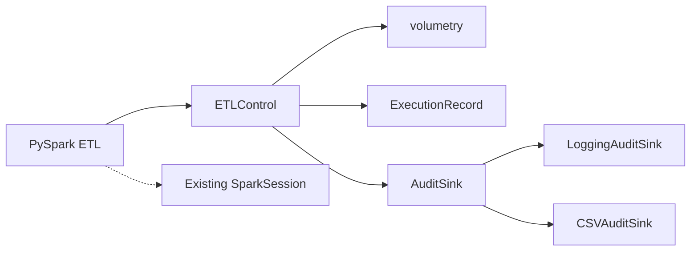

# ETL Quality Gate

Volumetry & audit control for PySpark ETLs — data-quality checks on the roadmap.


## 1. What is it & why?

`etl_quality_gate` is a reusable Python library to standardise volumetry and audit controls in PySpark ETLs. It captures execution identity, timing, status and errors; validates row counts against configurable min/max thresholds; persists an audit trail to CSV; and **propagates exceptions** so the job fails visibly.

It avoids coupling to any specific orchestration platform or AWS services, and has zero runtime dependencies (only the Python standard library). PySpark is optional.

## 2. Requirements & Installation

| Requirement | Value |
| --- | --- |
| Python | 3.11 or higher |
| Runtime deps | None (stdlib only) |
| PySpark | Optional |

**There is nothing to install.** The library is a plain folder — use it by copying `etl_quality_gate/` into your project (or by running from this repository's root):

```text
your-etl-project/
├── etl_quality_gate/     # copied from this repo
│   ├── __init__.py
│   ├── audit.py
│   ├── config.py
│   ├── control.py
│   ├── exceptions.py
│   ├── models.py
│   ├── py.typed
│   └── volumetry.py
└── your_etl.py
```

```python
from etl_quality_gate import ETLControl
```

Check:

```bash
python -c "from etl_quality_gate import ETLControl, __version__; print(__version__)"
```

> Future option: `pyproject.toml` is ready, so when the package is published (or if you ever want a local install) `pip install .` / `pip install "git+https://github.com/AbelPerezCollado/etl-quality-gate.git"` will work without any restructuring. For the MVP, copying the folder is the supported path.

## 3. Quick start

Example config (`examples/config.json`):

```json
{
  "process_name": "EXAMPLE_ETL",
  "min_rows": 80000,
  "max_rows": 120000,
  "on_violation": "WARN",
  "csv_path": "examples/audit.csv"
}
```

ETL snippet:

```python
from etl_quality_gate import ETLControl

with ETLControl.from_json("config.json") as control:
    df = spark.read.parquet("s3://input/table")
    control.validate(df)        # counts rows and checks min/max
    df.write.parquet("s3://output/table")
```

The library **does not create a SparkSession**. If you already know the row count, skip the Spark action:

```python
with ETLControl.from_json("config.json") as control:
    control.validate(row_count=95000)
```

## 4. How it works

### Features

- Lifecycle (`start`, `finish`) with `atexit` best-effort `ABORTED` handling.
- Volumetry: `min_rows` / `max_rows`, policy `FAIL` (raises) or `WARN` (continues with `SUCCESS_WITH_WARNINGS`).
- Audit sinks: `LoggingAuditSink` (default) and `CSVAuditSink` (append-only CSV).
- Strict config validation: unknown keys raise `InvalidConfigError`; min > max rejected.
- Exceptions propagate: `VolumeViolationError` or any ETL exception is recorded and re-raised.

### Architecture



## 5. Audit & CSV

Fields: `execution_id, process_name, start_time, end_time, duration_seconds, status, rows_count, error_code, error_message`.

Sample CSV (committed in `examples/output/audit.csv`):

```text
execution_id,process_name,start_time,end_time,duration_seconds,status,rows_count,error_code,error_message
sample-9d3f...,EXAMPLE_ETL,2026-10-19T10:00:00+00:00,,,RUNNING,,,
sample-9d3f...,EXAMPLE_ETL,2026-10-19T10:00:00+00:00,2026-10-19T10:00:00.015000+00:00,0.015,SUCCESS,95000,,
```

- CSV is append-only; directories created automatically.
- Multiple processes writing the same file are serialized with `flock` (best-effort, POSIX).
- Sink I/O failures never break the ETL (logged and swallowed by the control).

## 6. Configuration

| Key | Type | Notes |
| --- | --- | --- |
| `process_name` | string | Required |
| `min_rows` | int ≥ 0 | Optional |
| `max_rows` | int ≥ 0 | Optional |
| `on_violation` | `"FAIL" \| "WARN"` | Default `FAIL` |
| `csv_path` | string | Optional CSV path |
| `execution_id` | string | Override UUID |

Unknown keys → `InvalidConfigError`. `min_rows > max_rows` → `InvalidConfigError`.

```python
from etl_quality_gate import ControlConfig, ETLControl

cfg = ControlConfig.from_json("config.json")
cfg = ControlConfig.from_dict({"process_name": "ETL_X", "max_rows": 1000})
ctl = ETLControl(cfg)
```

## 7. Examples

A minimal, no-Spark example is included and runs **without any installation**, from any directory:

```bash
python examples/example.py
```

It uses a tiny `RowSet` class with `count()` to satisfy the `Countable` protocol. The committed sample CSV is at [`examples/output/audit.csv`](examples/output/audit.csv).

## 8. Distribution

**MVP (no pip involved):** ship the folder itself. Zip it and attach it to the Spark submission:

```bash
zip -r etl_quality_gate.zip etl_quality_gate
spark-submit --py-files etl_quality_gate.zip your_etl.py
```

The same zip works on EMR via `spark-submit --py-files` or cluster bootstrap. No code should be copied into the ETL job.

**Future (optional):** `pyproject.toml` is in place, so a wheel can be built and installed with pip once needed:

```bash
python -m pip install build
python -m build        # artifacts land in dist/
```

## 9. Limitations & Roadmap

**Limitations**

- `DataFrame.count()` is a distributed action; pass `row_count` if already known.
- Validation checks the DataFrame before writing — it does not guarantee a successful write.
- Calling `validate` twice overwrites `rows_count` for that execution.
- `atexit` cannot cover `SIGKILL`, OOM-kill or abrupt JVM crashes.
- Python < 3.11 is not supported.

**Roadmap**

1. S3 audit sink (`[aws]` extra) with explicit ETL permissions.
2. Historical volumetry comparison against previous CSV runs.
3. Optional rejected/written row counts.
4. Data-quality checks (nulls, duplicates) built on top of `ETLControl`.
5. Adapter for a specific orchestrator once capabilities are confirmed.

## 10. Development

The library itself is never installed — the tests and examples import it straight from the repository root. pip is only used to fetch the test runner (and optionally PySpark):

```bash
python -m pip install pytest                 # test runner only
python -m pytest tests -q                    # run tests (Spark tests auto-skip if pyspark missing)
python -m pip install pyspark                # optional, to run the Spark tests
python examples/example.py                   # run smoke example
```

Repository layout:

```text
etl-quality-gate/
├── .github/workflows/ci.yml
├── .gitignore
├── LICENSE
├── README.md
├── examples/
│   ├── config.json
│   ├── example.py
│   └── output/audit.csv
├── pyproject.toml
├── etl_quality_gate/
│   ├── __init__.py
│   ├── audit.py
│   ├── config.py
│   ├── control.py
│   ├── exceptions.py
│   ├── models.py
│   ├── py.typed
│   └── volumetry.py
└── tests/
    ├── test_config.py
    ├── test_control.py
    ├── test_csv_sink.py
    ├── test_spark_control.py
    └── test_volumetry.py
```

PEP 440 versioning: `0.3.0`. CI runs on Python 3.11 and 3.12.

## 11. Licencia (Resumen en español)

**Licencia MIT**: puedes usar, copiar, modificar, distribuir y sublicenciar este software, incluyendo uso comercial, siempre que se incluya la nota de copyright y la licencia original.

Ver [`LICENSE`](LICENSE) para el texto completo.

## Summary in Spanish (Resumen en español)

`etl-quality-gate` estandariza **controles de volumetría y auditoría** en ETLs PySpark. Registra ejecución (identificador, tiempos, estado, errores), valida recuentos contra `min_rows`/`max_rows`, guarda auditoría en CSV y propaga excepciones. Sin dependencias runtime; PySpark opcional. Política `FAIL`/`WARN`. Dos sinks (`LoggingAuditSink`, `CSVAuditSink`) con `flock` (best-effort). Configuración JSON estricta (claves desconocidas → error). Cierre `ABORTED` vía `atexit`. Ejemplo sin Spark en `examples/`. Tests: 53 pasan + 1 omitido si falta PySpark. Versión `0.3.0`.
