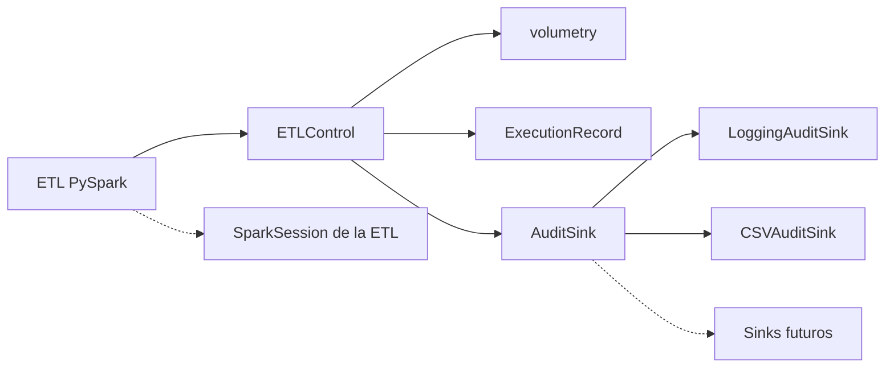

# ETL Quality Gate

Librería Python reutilizable para estandarizar los **controles técnicos y de volumetría** de las ETL PySpark del equipo de Data Engineering.

Versión actual: **0.3.0** (MVP).

## 1. Descripción y propósito

`etl_quality_gate` se incorpora a cada proceso ETL como una dependencia —no como código copiado—. Ofrece un contexto de ejecución que registra identificadores, tiempos, estados y errores, valida la volumetría contra umbrales configurados, persiste el resultado en CSV y **propaga las excepciones** para que EMR, SageMaker o el orquestador corporativo vean el fallo.

Está pensada para usarse en desarrollo (cluster EMR + notebook SageMaker) y en producción, sin acoplarse a ADA ni a servicios AWS concretos.

## 2. Problema que resuelve

Sin una capa común, cada Data Engineer reimplementa recuentos, logs y manejo de errores de forma distinta. Un proceso puede fallar sin rastro estructurado, o peor: un `try/except` demasiado amplio puede hacer que un job fallido se registre como correcto. Con esta librería, un fichero de configuración JSON estandariza los umbrales de volumetría y el registro de auditoría de todos los procesos del equipo.

## 3. Objetivos y alcance del MVP

**Implementado**

- Contexto `ETLControl` (inicio, fin, duración, estado).
- Identificador de ejecución (UUID, sobreescribible).
- `validate(df)`: valida el volumen contra `min_rows` / `max_rows` del JSON.
- Políticas `FAIL` / `WARN` en incumplimientos de volumen.
- Propagación de excepciones y estado `FAILED`.
- Cierre `ABORTED` por `atexit` (mejor esfuerzo).
- Configuración por dataclass / dict / JSON, sin Pydantic.
- Auditoría estructurada hacia logs (`LoggingAuditSink`).
- Persistencia del registro en CSV (`CSVAuditSink`), activable con `csv_path`.
- Paquete instalable (`pyproject.toml`, wheel).
- Pruebas unitarias sin Spark.

**No implementado (diseñado, no funcional)**

- Escritura del registro en S3.
- Repositorio central de auditoría, SNS, Lambda, DynamoDB, CloudWatch como destino.
- Comparación histórica de volumetría (media de ejecuciones previas).
- Integración con Engines ADA.
- Instalación automática en la creación del cluster.

## 4. Arquitectura propuesta

El núcleo solo depende de la librería estándar. PySpark es opcional. AWS y ADA quedan detrás de interfaces (`AuditSink`) o de documentación de distribución.

## 5. Diagrama de componentes



## 6. Estructura del repositorio

```text
etl-quality-gate/
├── README.md
├── pyproject.toml
├── LICENSE
├── src/etl_quality_gate/
│   ├── __init__.py
│   ├── control.py
│   ├── volumetry.py
│   ├── exceptions.py
│   ├── models.py
│   ├── config.py
│   └── audit.py
└── tests/
    ├── test_control.py
    ├── test_config.py
    ├── test_volumetry.py
    ├── test_csv_sink.py
    └── test_spark_control.py
```

No existe `logging.py` a propósito: sombrearía el módulo estándar `logging`.

## 7. Requisitos técnicos

| Requisito | Valor |
| --- | --- |
| Python | 3.11 o superior |
| Dependencias runtime | Ninguna fuera de la stdlib |
| PySpark | Opcional (`pip install etl-quality-gate[spark]`) |
| EMR | No se asume modalidad (EC2 vs Serverless) |

## 8. Instalación local

```bash
python3 -m venv .venv
source .venv/bin/activate
python -m pip install -e ".[dev]"
```

Comprobación:

```bash
python -c "from etl_quality_gate import ETLControl, __version__; print(__version__)"
```

## 9. Construcción del paquete wheel

```bash
python -m pip install build
python -m build
ls dist/etl_quality_gate-0.3.0-py3-none-any.whl
```

## 10. Distribución en S3

Ubicación **ilustrativa** (sustituir por el bucket aprobado):

```text
s3://<bucket-aprobado>/<prefijo>/etl-quality-gate/0.3.0/etl_quality_gate-0.3.0-py3-none-any.whl
```

Subir el fichero a S3 **no** instala el paquete en el cluster. Antes de instalar, valide el mecanismo (bootstrap, `--py-files` o `spark.submit.pyFiles`) con la versión de EMR real.

## 11. Incorporación en EMR

- **EMR sobre EC2 (desarrollo persistente):** bootstrap o `pip install` del wheel en el nodo driver; en notebooks SageMaker, instalar en el kernel.
- **Job PySpark:** `--py-files` apuntando al wheel versionado, o `spark.submit.pyFiles` en Serverless.
- **Validar** el mecanismo con la versión de EMR real. No todas las opciones existen en todos los modos.

La ETL no debe copiar el código fuente de esta librería en su job.

## 12. Ejemplo de uso en una ETL PySpark

Fichero de configuración (`config_etl.json`):

```json
{
  "process_name": "ETL_CLIENTES",
  "min_rows": 80000,
  "max_rows": 120000,
  "on_violation": "WARN",
  "csv_path": "logs/etl_audit.csv"
}
```

En la ETL:

```python
from etl_quality_gate import ETLControl

with ETLControl.from_json("config_etl.json") as control:
    df = spark.read.parquet("s3://entrada/clientes")
    control.validate(df)  # cuenta filas y compara con min_rows / max_rows
    df.write.parquet("s3://salida/clientes")
```

Al salir del bloque, el registro se escribe en el CSV (`SUCCESS` / `SUCCESS_WITH_WARNINGS` / `FAILED` con recuentos y error si lo hubo) y en los logs.

La librería **no** crea `SparkSession`. Debe existir una sesión activa creada por la ETL o el entorno.

## 13. Controles de volumetría

Si el recuento ya se conoce, pase `row_count` y evite una acción Spark:

```python
n = source.count()  # una sola acción Spark
control.validate(row_count=n)
```

Sin umbrales en el JSON, `validate` solo registra el recuento sin comparar.

Política informativa (no detiene el job):

```json
{ "process_name": "ETL_CLIENTES", "min_rows": 80000, "on_violation": "WARN" }
```

```python
with ETLControl.from_json("config_etl.json") as control:
    control.validate(row_count=10)  # fuera de rango
# estado final: SUCCESS_WITH_WARNINGS; no se lanza excepción
```

## 14. Gestión de excepciones

Cualquier excepción dentro del `with` se registra (`error_code`, `error_message`, estado `FAILED`) y **se vuelve a lanzar**. El job no termina como éxito.

`VolumeViolationError` (política `FAIL`, por defecto) es una excepción de control; también deja el estado en `FAILED` y se propaga.

Uso manual equivalente:

```python
control = ETLControl(ControlConfig(process_name="ETL_CLIENTES"))
control.start()
try:
    ...
    control.finish()
except Exception as exc:
    control.finish(exc)
    raise
```

Si no se pasa el error a `finish(exc)`, el estado final sería `SUCCESS`: pase siempre la excepción capturada.

Si ya se usa el context manager, no hace falta el `try` anterior: `__exit__` registra y re-lanza.

## 15. Auditoría y logs

Cada ejecución emite al menos dos eventos: `RUNNING` al entrar y el estado final al salir.

Campos del registro:

`execution_id`, `process_name`, `start_time`, `end_time`, `duration_seconds`, `status`, `rows_count`, `error_code`, `error_message`.

Los desconocidos van a `null`. El destino por defecto es el logger `etl_quality_gate.audit` (JSON). No se escriben credenciales ni el contenido de los DataFrames.

Para pruebas:

```python
from etl_quality_gate import ControlConfig, ETLControl, InMemoryAuditSink

sink = InMemoryAuditSink()
with ETLControl(ControlConfig(process_name="ETL_X"), audit_sink=sink) as control:
    ...
print(sink.records[-1].to_dict())
```

### Persistencia en CSV

Si la configuración incluye `csv_path`, el registro se persiste a un CSV además de ir a los logs (`CompositeAuditSink`):

- Una fila por evento (aprox. dos por ejecución: `RUNNING` y el estado final), con columnas `execution_id`, `process_name`, `start_time`, `end_time`, `duration_seconds`, `status`, `rows_count`, `error_code`, `error_message`.
- La cabecera se escribe una sola vez; los directorios padre se crean automáticamente.
- Varios jobs que escriban en el mismo fichero se serializan con bloqueo `flock` (best-effort, solo POSIX).
- Un fallo de escritura del CSV **no** afecta a la ETL: se registra en el logger y el job continúa.

`CSVAuditSink` también se puede usar directamente: `ETLControl(config, audit_sink=CSVAuditSink("ruta.csv"))`. Una `audit_sink` explícita tiene prioridad sobre `csv_path`.

Los destinos S3 / corporativos **no están implementados**. Implemente `AuditSink.emit`.

## 16. Configuración

Todo el comportamiento se configura en un único JSON plano:

| Clave | Tipo | Efecto |
| --- | --- | --- |
| `process_name` | string | Obligatorio. Identifica el proceso en auditoría. |
| `min_rows` | entero ≥ 0 | Umbral mínimo de filas. Opcional. |
| `max_rows` | entero ≥ 0 | Umbral máximo de filas. Opcional. |
| `on_violation` | `"FAIL"` \| `"WARN"` | Por defecto `FAIL`. `WARN` no detiene el job. |
| `csv_path` | string | Ruta del CSV de auditoría. Opcional. |
| `execution_id` | string | Sobreescribe el UUID (p.ej. id del Engine ADA). |

Carga en código:

```python
from etl_quality_gate import ControlConfig, ETLControl

config = ControlConfig.from_json("config_etl.json")      # desde fichero
config = ControlConfig.from_dict({"process_name": "ETL_X", "max_rows": 1000})  # desde dict
control = ETLControl(config)
```

Comportamiento ante datos inválidos:

| Caso | Resultado |
| --- | --- |
| Falta `process_name` o está vacío | `InvalidConfigError` al construir |
| Umbral no entero (p.ej. `"80000"` o `true`) | `InvalidConfigError` |
| Umbral negativo | `InvalidConfigError` |
| `min_rows > max_rows` | `InvalidConfigError` |
| Clave desconocida | `InvalidConfigError` |
| Umbral omitido | No se valida ese lado |
| `csv_path` vacío o no string | `InvalidConfigError` |

`validate` no admite umbrales por llamada: mandan siempre los del JSON.

## 17. Ejecución de pruebas

```bash
python -m pytest tests -q
```

Las pruebas Spark (`test_spark_control.py`) se omiten automáticamente (`pytest.importorskip`) si PySpark no está instalado. No sustituyen a las unitarias.

## 18. Versionado

PEP 440. La versión actual es `0.3.0`. El artefacto S3 debe incluir esa versión en la ruta. Incremente versión ante cambios de API.

Compatibilidad: no se eliminarán exports de `__all__` sin un cambio de versión mayor cuando el paquete salga de `0.x`.

## 19. Limitaciones conocidas

- `DataFrame.count()` es una acción Spark; puede ser costosa. Pase `row_count` si ya lo tiene.
- `validate` no demuestra que la escritura haya terminado bien: mide el DataFrame antes de escribir.
- Una segunda llamada a `validate` sobreescribe `rows_count` en el registro; la intención es una validación por ejecución.
- `atexit` no se ejecuta ante SIGKILL, OOM del driver o aborto nativo de la JVM.
- El núcleo no envía métricas a ningún servicio corporativo.
- Python anterior a 3.11 no es compatible con esta versión del paquete.
- No se valida la modalidad ni la versión concreta de EMR.

## 20. Roadmap de evolución

1. Sink de auditoría JSON/CSV en S3 (extra `[aws]`, permisos explícitos de la ETL).
2. Comparación histórica de volumetría: leer registros previos del CSV y saltar WARN si la media se desvía.
3. Recuentos de rechazados / escritos como métricas opcionales.
4. Extra de calidad de datos (nulos, duplicados) reutilizando `ETLControl`.
5. Adaptador ADA una vez validadas las capacidades reales de la plataforma.
6. Publicación en el índice pip corporativo, si existe.

## 21. Decisiones pendientes de validar con el entorno corporativo

- Existencia y uso obligatorio de un repositorio interno de paquetes Python.
- Modalidad EMR de desarrollo y de producción (EC2, Serverless u otra).
- Versión de Python embebida en esos clusters (debe ser 3.11+ o hay que relajar el bound).
- Si ADA permite `--py-files`, bootstrap, o un `pip install` previo al Engine.
- Dónde debe vivir el registro de auditoría a medio plazo (logs del job vs repositorio central).
- Convención corporativa para `process_name` y para reutilizar el id de ejecución del Engine.

Hasta que eso se confirme, la librería permanece desacoplada de ADA y de AWS.
